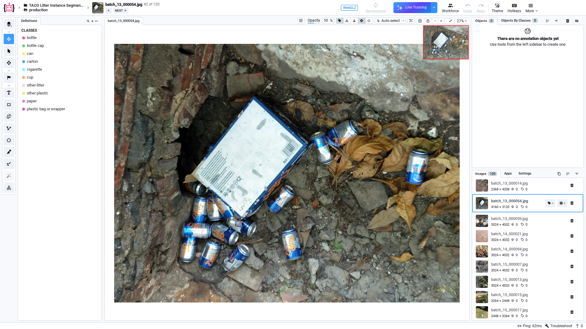

<div align="center" markdown>

# TACO Litter Instance Segmentation

150 phone photos of litter in real scenes, ready for instance segmentation: a calibration batch and a production batch.

[](https://github.com/supervisely-ecosystem/taco-litter-instance-segmentation/releases)
[](https://supervisely.com)
[](https://supervisely.com)



</div>

## Overview

This sample project contains 150 photos of litter in real scenes from the TACO dataset: bottles, cans, cups, cartons, wrappers, bottle caps and cigarette butts on pavement, grass, sand, dirt and near water. Each photo has between 3 and 30 litter items, often touching or overlapping. The images are split into two datasets:

- `calibration`: 30 images, the first batch a team labels to agree on the rules and measure time per object;
- `production`: 120 images, the rest of the volume.

The project has ten classes, each of shape **Any Shape**, so an item can be drawn as a polygon or as a mask, and no labels:

`bottle`, `bottle cap`, `can`, `carton`, `cup`, `plastic bag or wrapper`, `cigarette`, `paper`, `other plastic`, `other litter`.

Use it to:

- label every litter item as its own instance in the image labeling toolbox, with the Polygon tool, the Brush and the Smart Tool;
- run a calibration batch as a labeling job and the production batch as a labeling queue, with review and quality checks.

## How to Use This Project

1. Click **Get project** in the Supervisely Ecosystem and choose a team and a workspace.
2. Open the `calibration` dataset and an image in the image labeling toolbox.
3. Pick a class and label each litter item as a separate object.

See the complete workflow in [Inside an Instance Segmentation Annotation Project: Workflow, Quality, Speed, and Cost](https://docs.supervisely.com/use-cases/annotation-services/instance-segmentation-annotation-service-workflow-quality-cost).

## Download

Download the project in Supervisely format: [project.zip](https://github.com/supervisely-ecosystem/taco-litter-instance-segmentation/releases/download/v1.0.0/project.zip).

## Dataset Source and License

The images come from **TACO: Trash Annotations in Context Dataset** (v1.0) by Pedro F. Proença and Pedro Simões, published on [Zenodo](https://doi.org/10.5281/zenodo.3587843) (see also [tacodataset.org](http://tacodataset.org)). It is licensed under [CC BY 4.0](https://creativecommons.org/licenses/by/4.0/).

Citation:

> Proença, P. F., Simões, P. (2020). TACO: Trash Annotations in Context for Litter Detection. arXiv preprint arXiv:2003.06975.

```
@article{taco2020,
    title={TACO: Trash Annotations in Context for Litter Detection},
    author={Pedro F Proença and Pedro Simões},
    journal={arXiv preprint arXiv:2003.06975},
    year={2020}
}
```

Changes:

- 150 of the 1,500 images were selected: outdoor scenes (no images tagged *Clean* or *Indoor, Man-made*) with 3 to 30 labeled items each, chosen to cover all ten classes and the scene types. The images themselves are unchanged; each file is named after its source batch and file name (`batch_12/000031.jpg` is `batch_12_000031.jpg`).
- They were split into a `calibration` dataset (30 images) and a `production` dataset (120 images).
- The source's annotations are not included. The ten classes group TACO's super-categories: `bottle`, `bottle cap`, `can`, `carton`, `cup`, `cigarette` and `plastic bag or wrapper` (Plastic bag & wrapper) match one each; `paper` is Paper and Paper bag; `other plastic` is Other plastic, Plastic container and Plastic utensils; `other litter` is everything else, including lids, straws, broken glass, styrofoam and Unlabeled litter.
